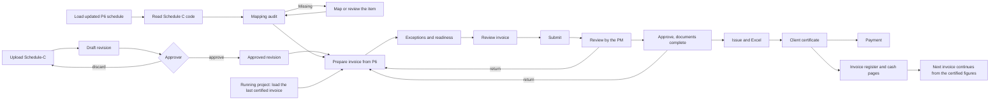

# Client Invoice Builder: design specification (ProTrackAI v3.48)

Invoices & Cash Flow → **Client Invoice Builder**. This document is the design of the function: what it does, for whom, how it is stored, how it calculates, how it is checked and how it grows. Every statement marked **Built** is in v3.48 (index.html, schema-update-v51.sql) and covered by its tests; **Planned** items are in the roadmap (section 15).

The reference Schedule-C and client invoice provided by alfanar were used as **templates of structure only**. None of their amounts, names or percentages is a system default. The demo's price schedule is generated from the demo schedule and labelled SAMPLE.

Contents:
1. Functional specification
2. User stories
3. Database schema
4. API architecture
5. UI/UX wireframes
6. Screen flows
7. P6 integration logic
8. Invoice calculation engine
9. Validation rules matrix
10. Migration of running projects
11. AI review engine
12. Dashboards
13. Notifications
14. Technical architecture and scale
15. Development roadmap
16. Test cases
17. Acceptance criteria
18. Future enhancements

---

## 1. Functional specification

### 1.1 Purpose
Replace the manual preparation of monthly client invoices for lump-sum EPC contracts priced by a contractual price schedule ("Schedule-C"). This covers substation, transmission, distribution, industrial and infrastructure projects for SEC, Saudi Energy, National Grid and GCC utilities.

The invoice is derived, never typed:
- **What** may be billed comes from the approved Schedule-C and its rules.
- **How much is earned** comes from approved Primavera P6 progress.
- **What was already paid** comes from the client's previous certificate.

### 1.2 Scope
| Area | Function | Status |
|---|---|---|
| Schedule-C | Upload XLSX, XLS or CSV. Read items, the parent/child hierarchy, line type, unit, quantity, rate, value, "Not Applicable" and "Included in Item …". Header (contract, value, currency, retention, advance, VAT, payment period). Revisions with approval | Built |
| Rules | Five rule types per component and per item; invoice limit per item | Built |
| P6 mapping | Activity code "Schedule C" read on schedule load or from an XER. Manual mapping. Mapping audit with Mapped, Missing, Reviewed and Milestone. Review of unmapped items | Built |
| Progress | Weighted % complete of the mapped activities in the updated schedule in force at the period end | Built |
| Invoice | Previous, this period and cumulative per item. Retention, its releases, advance recovery, VAT. Exceptions. Workflow | Built |
| History | Load the latest certified client invoice (Excel); per-component entry when only a PDF exists | Built |
| Review | Rules-based "Review invoice" | Built |
| Language-model review | Server LLM | Planned: on hold for alfanar IT |
| Output | Excel workbook: cover, summary, breakdown per component, retention, advance, forecast, SAP upload, exceptions, audit | Built |
| Client formats (v3.50) | The client's own invoice workbook kept as a format and filled cell by cell; rows rebuilt from the Schedule-C; the format's own totals checked against ProTrack's | Built |
| Cash flow | Issued invoices in the invoice register and cash pages; billing and collection forecast | Built |
| Dashboards | Client invoice, Schedule-C health, invoice readiness, waiting for you, portfolio | Built |
| Audit | Every change with who, when, before and after; append-only on the server | Built |
| Notifications | In-app list and count. E-mail and Approval Hub routing | In-app built; routing planned |

### 1.3 Business rules (summary)
1. An invoice uses the **approved** Schedule-C revision only. A revision is approved by someone other than its uploader.
2. Progress comes from **P6**. A typed % is allowed only for an unmapped item whose review records the reason and evidence; it is flagged everywhere.
3. No invoice is **submitted** while:
   - a priced item is unmapped and unreviewed;
   - the P6 update is older than the period start;
   - certified to date exceeds the contract value;
   - an earlier invoice is not yet certified;
   - the period overlaps another invoice.
4. "Review invoice" must have run on the **current** figures before submission.
5. **Separation of duties**:
   - the preparer does not review;
   - the preparer and the reviewer do not approve;
   - the uploader does not approve the Schedule-C.
6. Approval needs every **supporting document** marked attached or not applicable.
7. The next invoice continues from the **client-certified** cumulative amounts, not the amounts claimed.
8. A cumulative claim never exceeds the item's **invoice limit**. Progress below what was certified (**reversal**) claims nothing and keeps the certified amount.
9. Retention is deducted up to its cap and released at TCC and FAC by the contract's percentages. The advance is recovered at its rate until repaid. VAT is applied to the net.
10. An **issued** invoice is not cancelled; the client certifies it (possibly at a lower amount) or rejects it with a credit note.

### 1.4 Roles
| Business role | ProTrackAI role and right (default) |
|---|---|
| Planning Engineer | `plan`: `cib.setup`, `cib.map`, `cib.prepare` |
| Cost Engineer | `costing`: `cib.setup`, `cib.prepare`, `cib.certify` |
| Project Controls Manager | Head of Planning and Cost Control position: `cib.approve`. Give `cib.review` as needed |
| Project Manager | `pm`: `cib.review` |
| Commercial Manager, Division Manager | `rm` has `cib.approve`; give `cib.approve` to other approvers |
| Finance | Give `cib.certify` (custom role, or a person exception) |
| Administrator | `sa`: every right, and the rights screen |

Everyone also needs `money.view` and access to the project. Foremen never see client invoices.

---

## 2. User stories

| # | As a … | I want to … | So that … | Acceptance (see 17) |
|---|---|---|---|---|
| US1 | cost engineer | upload the contract's Schedule-C once | invoices use the contract's items and values | AC1–AC3 |
| US2 | approver | approve a Schedule-C revision someone else uploaded | only a checked price schedule drives invoices | AC4 |
| US3 | planning engineer | have the "Schedule C" activity code read when I load the updated schedule | the mapping stays current without extra work | AC5 |
| US4 | planning engineer | see which items have no activity, with their value and % | I fix the mapping before month end | AC6 |
| US5 | planning engineer | record why an item has no activity (no work yet, or a stated % with evidence) | the invoice can proceed honestly | AC7 |
| US6 | cost engineer | set the contract's rules (80/10/10, 90/10, TCC, FAC, phases) | each item bills as the contract says | AC8 |
| US7 | cost engineer | prepare the monthly invoice from P6 in one click | nobody types progress | AC9–AC11 |
| US8 | cost engineer | see every exception before I submit | the client never rejects for an error we could see | AC12 |
| US9 | reviewer, approver | run "Review invoice" | arithmetic, compliance and risk are checked the same way every month | AC13 |
| US10 | project manager | review an invoice someone else prepared | there is a second pair of eyes | AC14 |
| US11 | commercial or division manager | approve only when the documents are attached | the submission is complete | AC15 |
| US12 | cost engineer | export the invoice in the client's layout | I submit without reformatting | AC16 |
| US13 | finance | record the client's certificate, with different amounts where the client cut them, and the payment | the next invoice and the cash flow use the real figures | AC17–AC18 |
| US14 | cost engineer on a running project | load the last certified client invoice | invoice #9 continues from #8 without retyping history | AC19 |
| US15 | portfolio or project controls manager | see contract value, certified, claim, retention, balance, forecast and readiness for all my projects | I know where billing stands | AC20 |
| US16 | auditor | see who changed what, with before and after | the process is audit compliant | AC21 |
| US17 | treasury | see expected billing and collection by month | cash flow planning uses the contract rules | AC22 |

---

## 3. Database schema (schema-update-v51.sql)

```
cib_schedules  (id PK, project_id FK projects, rev, status Draft|Approved|Superseded,
                head jsonb {contract_no,title,client,issue_date,currency,value,ret_pct,ret_cap,ret_tcc,ret_fac,adv_pct,adv_rec,vat,pay_days},
                rules jsonb {GEN|ENG|MAT|CON|INS|TC|CLO|OTH: rule}, file_name, file_hash,
                created_by/name/at, approved_by/name/at)
                unique(project_id, rev); one Draft and one Approved per project (partial unique indexes)
cib_items      (schedule_id FK, project_id, item_no, seq,
                data jsonb {parent,lvl,line,desc,comp,unit,qty,rate,value,st Active|Not applicable|Included,incl,leaf,limit,rule})
                PK(schedule_id,item_no); index(project_id)
cib_maps       (project_id, act_id, item_no, act_name, src p6|manual, w, via wbs|code, by, at)  PK(project_id,act_id); index(project_id,item_no)
cib_map_reviews(project_id, item_no, decision manual|zero, pct, note (5..500), by, at)  PK(project_id,item_no)
cib_invoices   (id PK, project_id, seq, status Draft|Submitted|Reviewed|Approved|Issued|Certified|Paid|Cancelled, kind Progress|Migrated,
                schedule_id FK, period_from, period_to,
                data jsonb {ref,rev,su,dd,lines[],tot{},exc[],docs{},ai{},issued{},cert{},paid{},file},
                prepared_by/name, created_at, updated_at, hist jsonb[])
                unique(project_id,seq) where not Cancelled; one Draft per project
cib_audit      (id bigserial, project_id, action, ref, before_v, after_v, note, by_user, by_name, at_time)  append-only, no truncate
```

A **line** holds: `no, desc, comp, unit, qty, rate, value, rule, prog, src (p6|steps|ms|manual|zero|history|none), acts, cum_pay, prev_pay, this_pay, over, rev, prev_pct, prev_prog, cert_this, cert_cum`.

The **totals** (`tot`) hold: `cv, gross_prev, gross_this, gross_cum, ret_this, ret_cum, rel_this, rel_cum, rel_tcc, rel_fac, adv_amt, adv_this, adv_cum, net, vat, total, balance, vat_pct`.

**Row level security.** Reading every table needs `pt_money_ok() and can_see(project_id)`. Insert, update, delete and truncate are revoked; writes go only through `cib_act`.

---

## 4. API architecture

One write entry point, as in the other modules (rasa_act, boq, bcm): **`cib_act(p jsonb)`**, `security definer`. Each call checks:
- that the person is signed in and has access to the project;
- `money.view`, and that they are not a foreman;
- the operation's right.

| op | Right | Input | Server work |
|---|---|---|---|
| `sch_save` | cib.setup | pid, head, items[], rules, file, hash | Validates the header, numbers, duplicates, values and rules; creates the Draft revision and its items |
| `sch_head`, `sch_rules`, `sch_item` | cib.setup | sch, … | Draft only; validated; audited before and after |
| `sch_approve` | cib.approve (or the Head position) | sch, note | Not the uploader; the sum against the value needs a note; supersedes the previous revision |
| `sch_discard` | cib.setup | sch | Draft only |
| `map_save` | cib.map | rows[{act,item,name,src}], replace_p6, file | Manual mappings must point to an existing item; replace_p6 removes the stale P6 mappings |
| `map_review` | cib.map | item, d manual\|zero\|null, pct, note | Reason of at least 5 characters; % between 0 and 100 |
| `inv_save` | cib.prepare | to, from?, ref?, id? | **Works out the invoice itself** (`pt_cib_compute`); stores lines, totals and exceptions; a recalculated draft makes its review stale |
| `inv_migrate` | cib.setup | seq, to, lines[{no,cum}], ret_cum, rel_cum, adv_cum, rel_tcc, rel_fac, ref, file | Only before the first prepared invoice; amounts within the item values and the contract |
| `inv_ai` | prepare, review or approve | score, find[] | Stores the review (advisory) |
| `inv_docs` | prepare or approve | k, v yes\|na\|'' | Open invoices only |
| `inv_submit` | cib.prepare | id | Recalculates; refuses if the figures changed or anything blocks; the review must be current |
| `inv_review` | cib.review | id | Not the preparer |
| `inv_approve` | cib.approve | id | Not the preparer or reviewer; documents complete |
| `inv_return` | review or approve | id, note | From Submitted, Reviewed or Approved to Draft |
| `inv_issue` | prepare or approve | id, date, ref | Date not in the future, not before the period end |
| `inv_certify` | cib.certify | id, date, ref, lines{no: certified this period} | Never above claimed; works out retention, advance and VAT again on the certified amounts |
| `inv_pay` | cib.certify | id, date, amt, ref | Not above the total with VAT |
| `inv_cancel` | prepare (draft) or approve | id, note | Never after issue |

Read access: the six tables through PostgREST, under row level security. `cib_features()` returns `{version: 51, llm_review: false}`.

Internal functions (not callable by users):
- `pt_cib_can`: the right check;
- `pt_cib_rule`: the effective rule;
- `pt_cib_rule_err`;
- `pt_cib_pay`;
- `pt_cib_prog`;
- `pt_cib_compute`;
- `pt_cib_log`.

**In the browser**, `cibAct(op, p)` calls `cib_act` when signed in to the server, otherwise `cibActLocal`, which applies the same checks to the demo data.

---

## 5. UI/UX wireframes

```
┌ Client Invoice Builder ───────────────────────────── Project [TK2 · Thuwal 2 ▾] ┐
│ Dashboard(2) | Schedule-C | Mapping audit | Client invoices | Forecast | Audit  │
├─────────────────────────────────────────────────────────────────────────────────┤
│ ⚠ 2 price schedule items not mapped · SAR 149.5M (31.2%) · [Open the mapping]   │
│ [Contract value] [Certified to date] [Current claim] [Retention held]           │
│ [Balance to bill] [Forecast 3 months] [Days since last invoice] [Outstanding]   │
│ ┌ Schedule-C health ───────────┐ ┌ Invoice readiness · 50% ───────────────────┐ │
│ │ Mapped 82% · Unmapped 31%    │ │ ✓ Approved Schedule-C  ✓ Progress updated  │ │
│ │ Coverage 69% · Risk 25/100   │ │ ✗ Every item mapped    ✗ Documents 0 of 9  │ │
│ └──────────────────────────────┘ └────────────────────────────────────────────┘ │
│ Waiting for you: TK2 #04 Submitted → Review [Open]                              │
│ Portfolio: project | Schedule-C | coverage | risk | last | certified | open     │
└─────────────────────────────────────────────────────────────────────────────────┘

Invoice #04 · TK2-INV-04 [Draft]   [Recalculate from P6] [Review invoice] [Submit] [Cancel] [Excel]
 (Draft)(Submitted)(Reviewed)(Approved)(Issued)(Certified)(Paid)
┌ Exceptions ──────────────────────────┐ ┌ Readiness · 50% ──────────────────────┐
│ Blocks: 2 items not mapped …         │ │ ✓ … ✗ …                               │
│ Check: 1 code not in the schedule    │ └───────────────────────────────────────┘
└──────────────────────────────────────┘
┌ Invoice review · score 59/100 ──────────────────────────────────────────────────┐
│ High: Schedule-C and mapping: 2 items have no P6 activity                       │
│ OK: Mathematical accuracy: every line agrees with a fresh calculation           │
└─────────────────────────────────────────────────────────────────────────────────┘
┌ Invoice summary: component | contract | previously | this period | to date | % | balance ┐
│ Gross · −retention · +released · −advance recovery = Net · VAT · Total with VAT          │
┌ Schedule-C breakdown [component ▾]: item | description | value | rule | progress | prev | this | cum | % ┐
┌ Supporting documents: 9 rows [Missing ▾ Attached ▾ Not applicable ▾] ┐
┌ History ┐
```

**Schedule-C tab**:
- upload, then a preview (the components table, notes, the header form) and "Save as revision n (draft)";
- the revision with Approve or Discard;
- rules by component (rule type, then the % fields or phase steps);
- the item tree with filters, and "Change" per item (own rule, limit, component, reason).

**Mapping audit**:
- the alert and the KPIs;
- "Read the Schedule C activity code from P6" (XER, code type, preview, save);
- the audit table with Open per item: its activities, add an activity, or record a review;
- the list of codes not in the price schedule.

The screens work at phone width (one column under 760 px), in light and dark themes, using the app's own components.

---

## 6. Screen flows



---

## 7. P6 integration logic

1. **The item number** (v3.49):
   - **On the WBS**: the WBS user field **Schedule C** (XER tables UDFTYPE with table PROJWBS, UDFVALUE, UDFCODE). Every activity takes the value of its WBS or of the nearest WBS above it (PROJWBS parent chain); a child WBS with its own value keeps it.
   - **On the activity**: the activity code type **Schedule C**, its value (ACTVCODE.short_name) rather than its description. Where an activity has both, the activity code wins.
   - ProTrackAI accepts names such as "Schedule C", "Schedule-C", "Sched C" and "Price Schedule"; another field or code type can be chosen in the mapping audit.
   - Each mapping keeps where it came from (`via`: `wbs` or `code`).
2. **When read**:
   - automatically after an updated schedule is saved (`cibAfterSched`, on every project with a Schedule-C, for someone with `cib.map`);
   - or from an XER in the mapping audit.

   The XER is read by the same parser as Planning (`parseSchedXER`: TASK, PROJWBS, ACTVTYPE, ACTVCODE, TASKACTV, UDFTYPE, UDFVALUE, UDFCODE, RSRC, TASKRSRC).
3. **Replace rule**: mappings read from P6 replace the previous P6 mappings. Activities no longer coded are unmapped; mappings made by hand are kept.
4. **Progress source**: the server's `schedule_update_rows` of the update in force at the period end (the latest with data date ≤ the period end). It holds % complete (P6 duration, units or physical % by the activity's type) and the activity weight (the schedule's client weighting resource). The browser uses the same rows.
5. **The invoicing weight** (v3.49): the budgeted units (TASKRSRC.target_qty) of the resource **Schedule C Invoicing** (found by "Schedule C" or "invoicing" in its name or ID) on each activity, kept on the mapping as `w`. It is assigned only to the activities the contract invoices on, for example the inspection after delivery of a material.
6. **Weighted progress**:
   - Where any mapped activity of the item carries the invoicing weight: P(item) = Σ(invoicing wᵢ · pctᵢ) / Σ invoicing wᵢ over those activities only; the item's other activities are not invoiced on. Example: nine activities, PR to shipment at 100%, delivery at 26% carrying the weight: P = 26%.
   - Otherwise: P(item) = Σ(wᵢ · pctᵢ) / Σwᵢ over its mapped activities with the schedule weight. Activities with no weight count equally. Example: activities at 40, 60, 30 and 20% weighted 300, 400, 200 and 100 give 44%.
   - In a project that uses the invoicing weight, a mapped item (rules 1 and 2) with no weighted activity is listed in the audit and warned on the invoice (`weight`, not blocking).
7. **Phase steps** (rule 5): a step counts when its activity is 100% complete or has an actual finish on or before the period end.
8. **Milestones** (rules 1–4 releases): TCC and FAC come from the project's milestones (type TCC or FAC) with an actual date on or before the period end. The forecast uses the actual date, else the forecast, else the planned date.
9. **Audit of the mapping**:
   - an item with value and no activity is **Missing**;
   - a code not in the price schedule is listed;
   - a weighted activity with no code is counted;
   - a mapped activity missing from the latest update is listed;
   - a mapped item without the invoicing weight in a project that uses it is listed;
   - in the XER preview, an activity carrying the invoicing weight but no item is listed.

---

## 8. Invoice calculation engine

For each **billable item** i (a leaf, Active, value > 0) of the approved revision, at period end T:

```
r      = rule(component) overridden by the item's own rule
P      = progress (section 7), 0..1
TCC,FAC= milestone achieved by T
raw    = pay(r, value, P, TCC, FAC)
           pct  : v·P·cap% + [TCC]·v·tcc% + [FAC]·v·fac%        (cap+tcc+fac = 100)
           split: v·P·first% + [FAC]·v·(100−first)%
           tcc  : [TCC]·v          fac: [FAC]·v
           phase: P = Σ step% of completed steps, then as pct
cum    = round(min(raw, v·limit%), 2)
prev   = certified cumulative of the item in the last Certified/Paid invoice (or the loaded history)
if cum < prev − 0.5: reversal → cum = prev (nothing claimed, flagged)
this   = cum − prev
```

Totals:

```
gross_this = Σ this ;  gross_prev = Σ prev ;  gross_cum = gross_prev + gross_this
retention  = min(gross_this · ret%, max(0, CV·cap% − retention held so far))
release    = at the first invoice after TCC: held · ret_tcc% ; after FAC: held · ret_fac%
advance    = min(gross_this · recovery%, max(0, CV·adv% − recovered so far))
net        = gross_this − retention + release − advance
VAT        = round(net · VAT%, 2) ;  total = net + VAT ;  balance = CV − gross_cum
```

On **certification with changes**:
- each item's certified amount for the period replaces the claim;
- certified cumulative = prev + certified;
- retention, advance, net, VAT and total are worked out again on the certified gross;
- the next invoice uses the certified cumulative amounts.

The browser (`cibCompute`) and the server (`pt_cib_compute`) apply the same formulas. On the server, the stored invoice is the server's own result.

---

## 9. Validation rules matrix

| # | Check | Where | Severity | Message (abridged) |
|---|---|---|---|---|
| V1 | Header row with Item and Total | upload | refuse file | No header row with an Item number and a Total or Amount column |
| V2 | Item number ≤ 60, unique | upload, server | refuse | Item X appears twice |
| V3 | Values ≥ 0 | upload, server | refuse | negative value |
| V4 | Approved value > 0; retention 0–30; advance 0–50 with a recovery %; VAT 0–30; TCC% + FAC% ≤ 100; SAR | header, server | refuse | … |
| V5 | Rule percentages add up to 100; split 0–100 exclusive; phase steps named, with an activity, adding up to 100 | rules, server | refuse | … must add up to 100% |
| V6 | Invoice limit greater than 0 and at most 100 | item, server | refuse | … |
| V7 | One draft revision at a time; changes only to a draft | server | refuse | … |
| V8 | Approver is not the uploader; the sum against the value needs a note | server | refuse | Nobody approves a revision they uploaded |
| V9 | Manual mapping to an existing item | server | refuse | Item X is not in the price schedule |
| V10 | Review of an unmapped item: a reason of at least 5 characters, % between 0 and 100 | server | refuse | Give the reason |
| V11 | Unmapped priced item | invoice | **block** | N items not mapped |
| V12 | No P6 update by the period end, or one older than the period start | invoice | **block** | load this period's update first |
| V13 | P6 update more than 35 days before the period end | invoice | warn | … days older than the period end |
| V14 | Certified to date above the contract value | invoice | **block** | exceeds the contract value |
| V15 | Earlier invoice not yet certified | invoice | **block** | claim again only after its certificate |
| V16 | Period overlaps another invoice | invoice | **block** | Duplicate claim |
| V17 | Item at its invoice limit | invoice | warn | held at the limit |
| V18 | Schedule reversal | invoice | warn | earn less than already certified |
| V19 | Typed % used | invoice | warn | billed on a typed % |
| V20 | Codes not in the schedule; items certified before but missing now; items ≠ contract value; month's progress report not released; nothing to claim | invoice | warn | … |
| V21 | Figures changed since the calculation | submit, server | refuse | recalculate it first |
| V22 | Review not run on the current figures | submit, server | refuse | Run "Review invoice" first |
| V23 | Separation of duties (review, approve) | server | refuse | Nobody reviews or approves … |
| V24 | Documents complete before approval | server | refuse | Mark every supporting document … |
| V25 | Issue, certificate and payment dates valid and in order | server | refuse | … |
| V26 | Certified ≤ claimed; payment ≤ total with VAT | server | refuse | … |
| V27 | History: amounts ≤ item value and the contract; before the first invoice; advance recovered ≤ advance | server | refuse | … |

---

## 10. Migration of running projects

1. Upload and approve the Schedule-C (as for a new project).
2. **Load the latest certified client invoice** (Excel, Client invoices tab):
   - every sheet with item numbers is a candidate breakdown sheet;
   - the column headings are read across merged header rows ("Payment certified › Cumulative › Amount");
   - the best certified-to-date column is picked per sheet, and the person can change or skip it;
   - item numbers are matched exactly or by suffix (`2.1.1.1` → `A.SS.2.1.1.1`); an item on two sheets counts once;
   - the invoice number is read from "Payment certificate # nn" or "Invoice No" where found, and the person confirms it with the period end.
3. Enter the retention held, retention released and advance recovered to date (from the cover page).
4. ProTrackAI stores it as a **certified invoice of kind Migrated** with each item's certified cumulative. Invoice #(n+1) continues from it.
5. **PDF only**: keep the PDF in the document rack as evidence, and type the certified amount per component; it is spread over the component's items by value. Reading PDF tables is planned (section 18).
6. History is accepted only before the first prepared invoice, and never above an item's value or the contract value.

---

## 11. AI review engine

**Built (rules-based, in ProTrackAI; no external service):**

| Check | Method | Severity |
|---|---|---|
| Mathematical accuracy | Recalculate every line from P6, the rules and the previous certificate; Σ lines = gross; net and VAT follow | high if wrong, else OK |
| Contract compliance | Retention without a term; advance over-recovered; items at their limit; milestone items need their TCC or FAC certificate | high, medium, note |
| Missing Schedule-C items | Items Missing in the mapping audit | high |
| Unmapped activities | Weighted activities without a code (medium when above 5% of the weight); unknown codes; vanished activities | medium, low |
| Abnormal progress | Jump above 35 points × months since the last invoice; reversal; typed % | medium, high |
| Over-billing risk | Claimed above physical progress for rule 1; billed % to date above the schedule's progress + 5 points | high |
| High-value variances | Lines above 15% of the claim | note |
| Forecast impact | Claim against the month's forecast (±25%); when the balance is billed, and whether that is after the contract finish | medium, note |

Score = 100 − 25 × high − 8 × medium − 3 × low (minimum 0).

The review is stored with the invoice, and submission requires a review newer than the last recalculation.

**Planned: language-model review on ProTrack's server (on hold until alfanar IT and Cybersecurity approve, as in STAGE-44-SETUP).**
- The server endpoint receives only the invoice's own lines, exceptions and the rules review, never the browser's keys.
- It returns a narrative and any extra findings. These are labelled as model output and never change amounts.
- `cib_features().llm_review` turns true only after approval.

---

## 12. Dashboards

- **Client invoice dashboard** (per project):
  - contract value;
  - certified to date (and % of the price);
  - current claim (open invoice);
  - retention held after releases;
  - balance to bill;
  - forecast for the next three months;
  - days since the last invoice;
  - outstanding (certified, not paid, with VAT).
- **Schedule-C health**: items mapped %, unmapped %, value coverage %, risk score.

  Risk = 60 × unmapped value share + 15 × unmapped schedule weight share + 10 × value on typed % + 5 (unknown codes) + 10 (P6 update older than 35 days), capped at 100.
- **Invoice readiness**:
  - approved Schedule-C;
  - progress updated;
  - every item mapped or reviewed;
  - documents (n of 9);
  - review current;
  - no block.

  It shows a ready %.
- **Waiting for you**: across your projects: review, approve, issue, certify, finish a draft, approve a revision.
- **Portfolio**: every project in access with its Schedule-C, coverage, risk, last invoice, certified to date and open invoice.
- The **Cashflow Dashboard** and the **Cash-inflow forecast** include issued builder invoices through the invoice register.

---

## 13. Notifications

**Built:**
- the Dashboard tab's count and the "Waiting for you" list, worked out from each person's rights and the invoices' states (so it is the same for everyone, signed in or not);
- in-app messages (bell) in the browser that acts:
  - mapping gaps found when a schedule is loaded;
  - submitted, reviewed, approved and returned invoices.

**Planned** (needs the server mail service of v3.40 and the Approval Hub link of v3.41):
- e-mail to the reviewers when an invoice is submitted, and to the approvers when it is reviewed;
- a reminder when an approved invoice is not issued within N days;
- a digest of Missing items to the project's planning engineers after each schedule load;
- routing the approval through Approval Hub where the client requires it.

---

## 14. Technical architecture and scale

- **Client**:
  - the single-page app (index.html), with the module `cib*` (engine, readers, review, forecast, Excel, screens);
  - SheetJS reads XLSX, XLS and CSV; ExcelJS writes the invoice.
- **Server**: Supabase PostgreSQL.
  - `cib_act` (plpgsql, security definer) is the only write path;
  - row level security on every table;
  - the append-only audit trail.
- **Data flow**:
  1. P6 XER → Planning upload → `schedule_update_rows`;
  2. the "Schedule C" WBS field or code, with the invoicing weight → `cib_maps` (v52: `w`, `via`);
  3. `pt_cib_compute` → `cib_invoices`;
  4. issued invoices → invoice register view → cash pages.
- **Scale (more than 1,000 projects)**:
  - every table is keyed or indexed by `project_id`;
  - the invoice calculation is per project, O(items + mapped activities), with indexed joins on `(project_id, act_id)` and `(update_id, act_id)`;
  - one draft and one approved revision per project are enforced by partial unique indexes;
  - Schedule-C up to 6,000 items;
  - the audit index is `(project_id, at_time desc)`.
- **Known limit, planned**: the browser loads the client-invoice tables for all projects in access at sign-in, as the other modules do. Above a few hundred active projects, load per project on opening the screen (section 15, R2).
- **Security**: no amount from the browser is trusted; separation of duties and every state change are checked on the server; foremen are excluded; no API key in the browser; the LLM review is on hold.
- **Audit compliance**: who, when, before and after for every change; append-only on the server; workbooks marked DRAFT until approved.

---

## 15. Development roadmap

| Release | Content | Status |
|---|---|---|
| R1 (v3.48) | Everything marked Built in this document; schema v51; tests (27 browser, 85 server) | Done in the prototype; **not yet run on Supabase** |
| R1.1 | Run v51 on a staging copy; pilot on two projects (one new, one running) with the real Schedule-C and the last certified invoice; tune the readers to any other client layouts | Next |
| R2 | Per-project lazy loading of client-invoice data; a server function for the forecast; bulk Schedule-C upload | Planned |
| R3 | E-mail and Approval Hub routing (section 13); reminders | Planned |
| R4 | Variation orders as Schedule-C items, linked to the change order log; change-order value on the cover | Planned |
| R5 | Arabic invoice pages (bilingual cover and tax invoice); PDF export of the invoice set | Planned |
| R6 | Language-model review on the server | **On hold until alfanar IT approves** |
| R7 | SAP posting of the "SAP upload" sheet through the approved interface | Planned; needs the SAP team |

---

## 16. Test cases

**Browser** (`tests/client_invoice_builder_demo.js`, 27 checks, all passing):
1. Version.
2. Menu, screen and rights.
3. Default rights by role.
4. The demo's SAMPLE data, labelled.
5. Reading a Schedule-C:
   - headings and priced items;
   - "Not Applicable";
   - "Included in tem …";
   - a leading space;
   - duplicates;
   - components.
6. The five rules and their checks.
7. Weighted progress: 40/60/30/20 → 44%; equal weights → 37.5%.
8. Revisions:
   - foremen and site engineers refused;
   - one draft at a time;
   - no self-approval;
   - the approver approves.
9. An approved revision is frozen; header checks.
10. The mapping read on schedule load; the missing item; the notification.
11. History: amounts within value; certified #2.
12. An unmapped item blocks.
13. Review of an unmapped item: reason required; typed % flagged.
14. Previous, this period, cumulative; limit; retention, advance and VAT arithmetic.
15. Exceptions: reversal, limit, contract value, stale P6, unreleased report.
16. Review invoice: arithmetic OK, tampering caught, mapping, typed % and forecast checks; review required before submission.
17. Separation of duties in review and approval; documents required.
18. Issue date check; the register row.
19. Certificate: never above claimed; changed amounts give the totals.
20. Payment: limit; the register shows it collected.
21. The next invoice starts from the certified figures; overlap; a second draft refused.
22. Cancel with a reason.
23. Forecast.
24. Excel workbook sheets.
25. The audit trail with before and after.
26. Foremen and read-only users.
27. Every tab draws.

**Server** (`supabase/tests/test_v51.cjs`, 85 checks, all passing): install twice; rights, defaults and the head position; the pay function and rule checks; revisions; mapping (P6 replace, manual validation, idempotence); the invoice worked out on the server, including:
- weighted progress (45% → 1,440);
- phase steps (900);
- split (9,000);
- TCC rule (0, then 500);
- not-applicable items excluded.

Then:
- unmapped block and its review;
- totals;
- review before submission;
- separation of duties;
- documents;
- return reason;
- issue and certificate with changes (8,040, totals on the certified amount);
- payment limits.

The next invoice is checked for:
- the certified basis;
- the TCC releases, both the share and the retention;
- reversal;
- phase completion;
- cancel and redo;
- manual remapping;
- submission refused after the figures changed.

Also covered: history on a running project (#8 → #9) and the stale-P6 block; reads for planning, foremen, outsiders and read-only users; no direct writes; the engine not callable; the audit actions; append-only; rollback and reinstall.

Re-run with the builder in place: `cash_inflow_demo.js` 28/28, `cashflow_dashboard_demo.js` 28/28, `rasa_hub_demo.js` 25/25.

---

## 17. Acceptance criteria

| AC | Criterion | Verified by |
|---|---|---|
| AC1 | A Schedule-C in the client's layout uploads with every priced item; their total equals the file's total | browser 5; reference file (structure check) |
| AC2 | Not-applicable and included items carry no value; headings are not billed | browser 5; server |
| AC3 | Each item has its component and parent | browser 5 |
| AC4 | Only an approver other than the uploader approves a revision; approved revisions are frozen | browser 8–9; server |
| AC5 | Loading an updated schedule with the "Schedule C" code maps its activities | browser 10 |
| AC6 | Missing items, their value and % show in the audit and the alert | browser 10; screen |
| AC7 | A typed % needs a reason and is flagged | browser 13; server |
| AC8 | Rules 1–5 bill as specified, with the invoice limit | browser 6, 14; server |
| AC9 | Progress is the weighted P6 % complete | browser 7; server (45%) |
| AC10 | Lines show previous, this period, cumulative; totals with retention, advance and VAT are exact to the halala | browser 14; server |
| AC11 | The next invoice continues from the certified figures | browser 21; server |
| AC12 | Blocking exceptions stop submission | browser 12, 15; server |
| AC13 | "Review invoice" catches a tampered line and must be current to submit | browser 16; server |
| AC14 | The preparer does not review | browser 17; server |
| AC15 | The preparer and reviewer do not approve; documents are required | browser 17; server |
| AC16 | The Excel workbook has the client layout's sheets | browser 24 |
| AC17 | A certificate never exceeds the claim; changed amounts flow into the totals | browser 19; server |
| AC18 | Issued, certified and paid invoices show in the invoice register and cash pages | browser 18, 20 |
| AC19 | The last certified invoice of a running project loads and #(n+1) continues from it | browser 11; server |
| AC20 | Dashboards show the measures of section 12 | browser 27; screen |
| AC21 | Every action is in the audit trail with before and after; append-only on the server | browser 25; server |
| AC22 | The forecast gives billing and collection by month, never above the contract | browser 23 |
| AC23 | Foremen never see client invoices; outsiders see nothing of other projects | browser 26; server |

---

## 18. Future enhancements

1. **Language-model review** on the server, once approved, as a narrative beside the rules review.
2. **Reading PDF invoices**: tables from certified invoice PDFs, with a side-by-side confirmation.
3. **Variation orders and claims**: approved change orders become Schedule-C items or revisions automatically from the change order log; the change-order value goes on the cover.
4. **Client-specific layouts**: built in v3.50 (section 19). Still to come: a format that also fills the attachment checklist and the SAP upload sheet of the client's workbook.
5. **SAP integration**: post the SAP upload sheet through the approved interface; reconcile against SAP billing.
6. **Quantity-based items**: items billed by measured quantity (EA, km) from the BOQ Engine or daily reports, beside lump-sum progress.
7. **Earned-value cross-check**: compare invoice progress with internal progress and the cost report's EAC each month.
8. **Approval Hub and e-mail routing** with reminders and escalation.
9. **Retention bonds**: retention released against a bond.
10. **Portfolio analytics**: billing lag, rejection rate and certification cuts by client; days sales outstanding.
11. **Mobile approvals**: review and approve on the phone layout with the review summary.
12. **Per-project data loading** for very large portfolios (R2).

---

## 19. Client invoice formats (v3.50)

**Purpose.** Each client wants its own invoice workbook: tax invoice (often bilingual), cover page, invoice summary, a breakdown sheet per price component, forecast, and hidden sheets of its own. A format is that workbook, kept once per client, and every invoice is exported into it.

**Keeping a format** (Client Invoice Builder → Invoice formats, right `cib.setup`):
1. Upload a certified invoice workbook of the client (.xlsx, at most 25 MB; .xlsm refused). Its figures are never used.
2. ProTrack reads its layout (`cibfScan`):
   - **breakdown tables**: the column holding item numbers (A.SS.3.1.1, X.1 …) and, for each column, its heading path (for example CERTIFIED PROGRESS › PREVIOUSLY › %) giving its role: progress or payment, previously / this period / to date, % / quantity / amount; contract unit, quantity, rate, amount, description. Columns that are formulas stay formulas. A table may run across page blocks (a signature block repeated per printed page).
   - **component** of each table: from the items of the project's Schedule-C, else the sheet's name (GENERAL, ENGINEERING, MATERIAL, CONSTRUCTION, INSTALLATION, TESTING …);
   - **header cells**: a label (Invoice No, Date of Invoice, Due Date, From / To, Contract No, Project Name, Contract Value, Type of Invoice, Contractor:, Client:, Retention, Advance recovery, VAT %) and its cell to the right or below; a formula there is the format's own figure and is not written; net payable, VAT and total with VAT as formulas are recorded to check;
   - **TCC and FAC lines** under previously / this period headings; the **invoice number inside a title** (PAYMENT CERTIFICATE # 01); the **forecast list** (Invoice No. 01, 02 … with a gross amount and status).
   - Hidden sheets and price lists are kept as they are unless chosen.
3. The keeper checks the map: each sheet (fill, keep, take out), each table's component and rows (rebuilt from the Schedule-C, matching rows only, or left), each header cell's field. Saved with name and client (or any client).

**Exporting** (an invoice → format → Excel invoice). `cibfFill` edits the workbook's XML directly (JSZip):
- only the cells of the map change; logos, drawings, comments, links to other workbooks, styles, print settings, hidden sheets and every formula stay;
- a table's item rows become the Schedule-C items of its component, in order: rows are inserted at the last item row (inside every total's range) or taken out from the end, as Excel does, with every reference in the workbook moved (formulas on any sheet, merged cells, print areas and names, conditional formats, drawings and comments); a reference into a removed row becomes #REF! and is counted;
- progress % previously and this period, payment % or amounts where the format types them; TCC and FAC parts apart where the format has those lines;
- then every formula is worked out (`xlCalc`: arithmetic, comparisons, ranges, SUM, ROUND, IF, IFERROR, MIN, MAX …) and its figure written, so the file shows the figures before Excel recalculates it (Excel recalculates on opening);
- **checks**: each table's payment this period, the TCC and FAC amounts, and the format's own net payable, VAT and total against ProTrack's invoice. A difference (for example a format paying 80% on progress where the approved rules say 90%) is named; so are items missing from the format and rows set to zero.
- The export is noted in the audit trail (`inv_export`).

**Server** (schema-update-v53.sql): `cib_formats` (name, client, file path, size, hash, map, history), the private bucket `cib-formats` (fmt/<id>.xlsx, .xlsx only, 25 MB), `cib_fmt_act` (fmt_add after the file is stored, fmt_map, fmt_del; then the file may be removed), read by those who see billing figures. The browser fills the workbook; the server never runs it.

**Verified** against a real client workbook of 21 sheets (structure only): the evaluator gives Excel's own figure for all 3,463 formulas; rows inserted and removed on MATERIAL and CONSTRUCTION keep the summary's links and leave no new error in Excel (the same 80 error cells as the client's file, from its external links); the format's material total equals ProTrack's.
